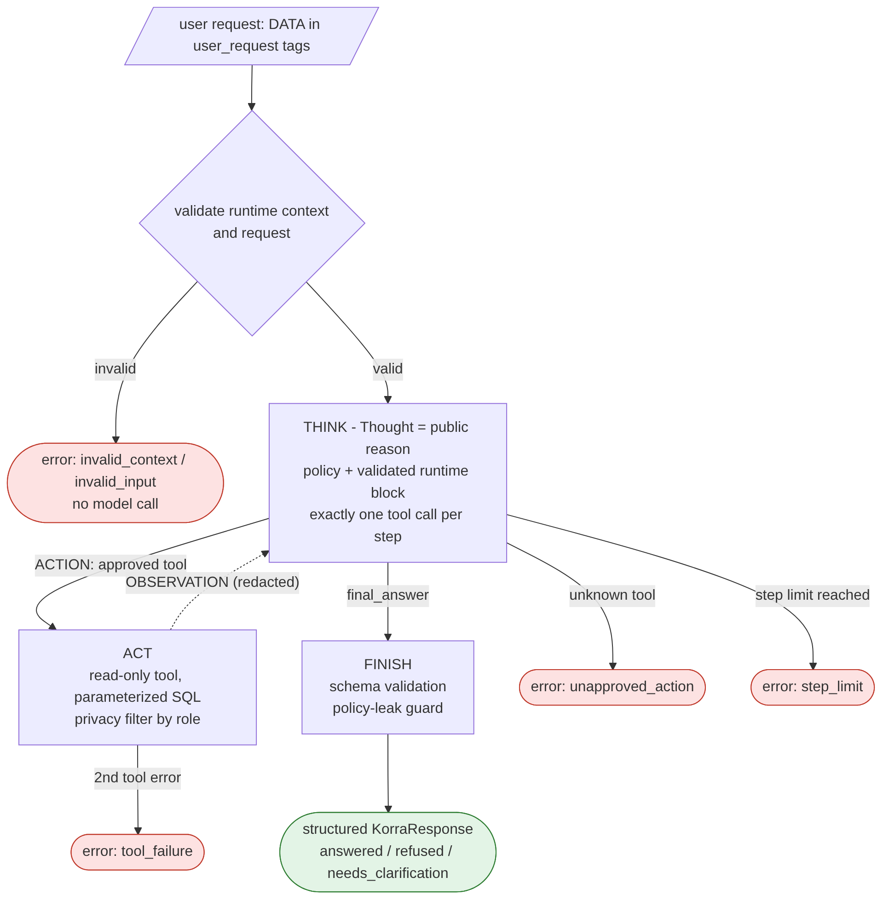

# Korra: an AI agent built step by step

**Lia Surguladze** · COMPE 475 Computer Architecture · San Diego State University · Fall 2026

Korra is an AI agent I built over the semester. It started as a simple chatbot and grew, one project at a time, into an agent that uses tools, remembers conversations in a database, asks a human before risky actions, and follows a tested behavior policy.

Each folder is one stage. Every stage runs in Docker and has its own README with setup steps and evidence.



## Timeline

| # | Stage | Date | What I added |
|---|---|---|---|
| 01 | [Chatbot](01-chatbot) | Oct 2026 | LangGraph + Google Gemini chat loop, Docker image with no secrets inside |
| 02 | [Tools + C extension](02-tools-c-extension) | Oct 2026 | Web search tool and my own **C program** (file statistics, 28 unit tests) called by the agent; two-stage Docker build |
| 03 | [Persistence and streaming](03-persistence-and-streaming) | Oct 2026 | Memory that survives restarts (SQLite, then PostgreSQL), thread IDs, token streaming, database tools on their own graph nodes |
| 04 | [Human in the loop](04-human-in-the-loop) | Oct 2026 | Agent pauses before writing to the database; a reviewer approves, rejects, or revises; exactly-once writes; audit log |
| 05 | [System prompts](05-system-prompts) | Oct 2026 | Behavior policy, validated prompt templates, controlled ReAct loop, privacy rules, prompt-injection defense; **21/21 behavior tests pass** |
| 06 | Multi-path processing | Nov 2026 | *coming soon* |

## Skills shown

- **AI agents:** LangGraph, ReAct loops, tool calling, human-in-the-loop, prompt design and testing
- **Languages:** Python, C, SQL
- **Systems:** Docker and Docker Compose, PostgreSQL, SQLite
- **Safety:** secrets kept out of code and images, role-based privacy, input validation, audit logging

## Run any stage

Each stage needs its own `.env` file (copy `.env.example` and add your API key). Then follow the README in that folder. Most stages run with:

```
docker compose up
```

> All student records in these projects are made-up test data.
